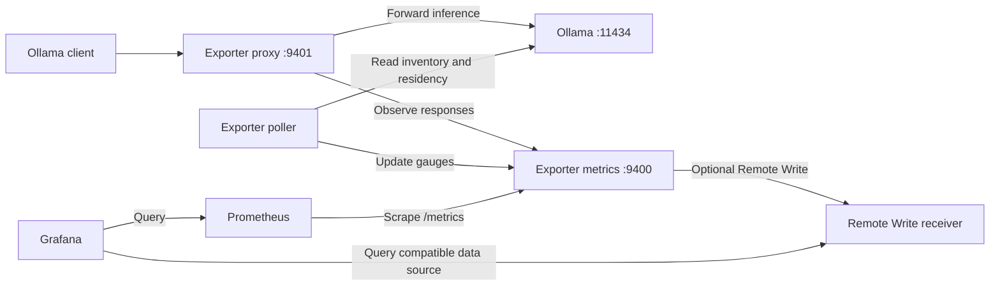

# ollama-exporter

[](https://github.com/maravexa/ollama-exporter/actions/workflows/ci.yaml)

A Prometheus exporter for [Ollama](https://ollama.com). It tracks model residency,
inference timing and token throughput, with optional GPU metrics and Prometheus
Remote Write output.

This README describes the current source tree. Check the
[release notes](https://github.com/maravexa/ollama-exporter/releases) when using a
published binary or container; changes on `main` may not be released yet.

## How it works

- **Poller:** reads `/api/ps` and `/api/tags` for model inventory and memory state.
- **Proxy:** forwards requests to Ollama and extracts inference metrics from
  responses. Point your client at port **9401** to collect per-request metrics.
- **Output:** serves `/metrics` on port **9400**, with optional Remote Write push.

Polling runs independently of the proxy. If Ollama itself is unreachable, polling
cannot provide fresh model state; `ollama_up` reports that failure.

Native `/api/generate` and `/api/chat` support NDJSON streams and single-object
`stream:false` responses. The proxy forwards original response bytes, including
thinking fields, and flushes each read without accumulating the response body.

On a Linux test host with Open WebUI 0.12.3, Ollama 0.34.0 and `qwen3.5:9b`, manual checks
confirmed progressive thinking through the proxy and, in a separate matched test
with thinking disabled, progressive answers on both direct and proxied routes.
These checks did not verify an Open WebUI thinking-to-answer transition within one
response, live `/v1` behavior, or Jetpack/Orin. See the
[scoped validation](https://github.com/maravexa/ollama-exporter/issues/27#issuecomment-6324349163).

### Compatibility routes and usage

POST `/v1/chat/completions`, `/v1/completions` (OpenAI), and `/v1/messages`
(Anthropic) support JSON and `text/event-stream` SSE responses. Other routes,
including `/v1/messages/count_tokens`, are forwarded without inference extraction.
SSE handles fragmented reads, CRLF, multiline `data:` events, `[DONE]`, and
Anthropic counts split between `message_start` and `message_delta` followed by
`message_stop`. Successful HTTP responses must reach clean EOF; SSE must also
include its terminal marker. Truncated, cancelled, malformed, and error responses
do not create completion observations. Request duration and in-flight cleanup
still run on reverse-proxy aborts. Duration measures proxy handling from handler entry through body forwarding or
abort, including request-prefix inspection but excluding metadata lookup.

Compatibility usage availability depends on the Ollama version and route. OpenAI
clients should request `stream_options: {"include_usage": true}` when their server
supports it. Streams without that option may omit usage. The exporter forwards
requests unchanged: it does not inject this option or add usage frames. No specific
installed-server support is assumed. Missing or null counts produce **no** token
observation; an explicit zero produces one zero-valued observation.

`ollama_compatibility_input_tokens` and `ollama_compatibility_output_tokens` are
histograms of reported primary counts per completed request, with `model`, `family`,
`quant`, and `endpoint` labels. Their `_sum` values accumulate known tokens and
`_count` values count requests that reported each field. Use `rate(..._sum[5m])`
for aggregate reported token throughput over a scrape window. This is not a
per-request decode speed. No wall-time throughput or native phase timing is
fabricated for compatibility routes. Input counts are API-specific: separate
Anthropic cache-read/cache-creation token fields are not added to `input_tokens`
or exported as cache metrics. The input histogram is not a normalized cross-API
prompt total. Native `ollama_tokens_per_second` retains
its `eval_count / eval_duration` meaning; native prompt throughput retains
`prompt_eval_count / prompt_eval_duration`.

`ollama_requests_total` counts native completed (`done:true`) inferences and
completed compatibility responses, including compatibility responses with no
usage. It does not count every HTTP request; the duration histogram counts
proxied requests unless their paths are configured as excluded. Non-2xx responses
are forwarded without inference extraction. Exclusions also disable extraction.

The metrics parser validates JSON incrementally, skipping
large generated strings and context arrays with bounded storage; there is no
object or line size limit. Nesting beyond 64 levels or selected scalar values
beyond 4096 encoded bytes disables extraction while forwarding continues. Field
names beyond 128 encoded bytes are ignored. Request model lookup retains and
replays at most the first 64 KiB, closing the original body normally. If `model`
occurs later, request duration/in-flight labels use the query model or an empty
model; inference labels use a response model when available. Model metadata still
uses the existing cache and fallback behavior.

Extraction diagnostics use bounded reason labels to distinguish missing usage,
incomplete responses, invalid fields, malformed JSON, upstream errors, and parser
limits. Oversized field names have a separate skip counter so useful metrics from
other fields remain visible. See [the metric reference](docs/metrics.md#extraction-diagnostics-proxy-mode).
CI and scheduled scans use [the shared production vulnerability gate](docs/vulnerability-gate.md).
Historical toolchain and live-test evidence is retained in
[the security assessment](docs/security-assessment.txt),
[the release assessment](docs/release-validation.txt), and
[the Ollama 0.40.3 live results](docs/live-validation.txt). These are dated results,
not substitutes for the current CI gate.

### Output: Pull and/or Push

By default the exporter exposes `/metrics` for Prometheus to scrape. Optionally
it can also (or instead) **push** samples to any Prometheus Remote Write 1.0
endpoint — Mimir, Grafana Cloud, Thanos Receive, VictoriaMetrics, or anything
else that speaks the protocol. Push and pull work together; either can be
disabled.

See [docs/remote-write.md](docs/remote-write.md) for the full reference,
[docs/alloy-vs-native-push.md](docs/alloy-vs-native-push.md) for guidance on
when to use which approach, and [examples/](examples/) for ready-to-edit
configs against Mimir and Grafana Cloud.

### Metric labels and lifetime

Metrics use the `ollama_` prefix. Model metrics include model, family and
quantization labels; proxy metrics may also include the endpoint. Prompt and
response text are not metric labels. Model names still contribute to cardinality.

Throughput gauges are calculated from reported inference timings when responses
complete. The KV-pressure metric is a prompt-evaluation timing proxy, not a direct
measurement of KV-cache occupancy. Deleted models are removed from current-state
gauges and the metadata cache after a successful inventory poll. Cumulative
counters, histograms and Prometheus history remain available.

### Key Metrics

| Metric | Type | Description |
|---|---|---|
| `ollama_up` | Gauge | Ollama API health (1=up, 0=down) |
| `ollama_model_loaded` | Gauge | 1 if model currently in VRAM, 0 after unload |
| `ollama_model_vram_bytes` | Gauge | VRAM consumed per loaded model; resets to 0 on unload |
| `ollama_model_load_total` | Counter | Cumulative load events per model (including startup) |
| `ollama_model_unload_total` | Counter | Cumulative eviction events per model |
| `ollama_model_load_events_total` | Counter | Load transitions observed after startup (excludes models present at launch) |
| `ollama_model_unload_events_total` | Counter | Unload transitions observed after startup |
| `ollama_model_load_duration_seconds` | Histogram | Model load time from proxied response `load_duration` field |
| `ollama_request_duration_seconds` | Histogram | End-to-end request latency |
| `ollama_load_duration_seconds` | Histogram | Per-request model load time (model/family/quant labels) |
| `ollama_prompt_eval_duration_seconds` | Histogram | Prompt evaluation time |
| `ollama_eval_duration_seconds` | Histogram | Token generation time |
| `ollama_tokens_per_second` | Gauge | Derived: eval_count / eval_duration |
| `ollama_prompt_tokens_per_second` | Gauge | Derived: prompt_eval_count / prompt_eval_duration |
| `ollama_requests_in_flight` | Gauge | Current concurrent requests (proxy mode) |
| `ollama_requests_total` | Counter | Completed inferences by model and endpoint |
| `ollama_compatibility_input_tokens` | Histogram | Reported input counts per completed compatibility request |
| `ollama_compatibility_output_tokens` | Histogram | Reported output counts per completed compatibility request |
| `ollama_kv_cache_pressure_ratio` | Gauge | Derived: prompt eval duration / token ratio trend |

#### GPU Metrics (AMD, amdgpu driver)

| Metric | Type | Description |
|---|---|---|
| `ollama_gpu_utilization_percent` | Gauge | GPU utilization 0–100, from `gpu_busy_percent` in sysfs |
| `ollama_gpu_temperature_celsius` | Gauge | GPU temperature in °C, from hwmon `temp1_input` (millidegrees ÷ 1000) |
| `ollama_gpu_vram_used_bytes` | Gauge | VRAM in use, from `mem_info_vram_used` |
| `ollama_gpu_vram_total_bytes` | Gauge | Total VRAM, from `mem_info_vram_total` (cached at startup) |
| `ollama_gpu_power_watts` | Gauge | Power draw in watts, from hwmon `power1_average` or `power1_input` (microwatts ÷ 1 000 000) |
| `ollama_gpu_clock_mhz{type="gpu"}` | Gauge | Active GPU core clock in MHz, from `pp_dpm_sclk` |
| `ollama_gpu_clock_mhz{type="memory"}` | Gauge | Active memory clock in MHz, from `pp_dpm_mclk` |

All GPU metrics carry `gpu` (card index: "0", "1", …) and `name` (product name or "amdgpu_cardN") labels.

#### GPU Metrics (Apple Silicon, macOS)

| Metric | Type | Description |
|---|---|---|
| `ollama_gpu_utilization_percent` | Gauge | Whole-GPU utilization 0–100, from IOAccelerator `Device Utilization %` (includes display/compositor work) |
| `ollama_gpu_vram_used_bytes` | Gauge | GPU footprint in unified memory, from IOAccelerator `In use system memory` |
| `ollama_gpu_vram_total_bytes` | Gauge | Total unified memory, from `sysctl hw.memsize` (cached at startup) |

Temperature, power and clock metrics are not emitted on macOS. Labels are `gpu="0"` and `name` (from `machdep.cpu.brand_string`, e.g. "Apple M4").

Full reference: [docs/metrics.md](docs/metrics.md)

## Installation

### Binary or source build

Linux amd64 and arm64 binaries, Debian packages and RPM packages are available from
[GitHub Releases](https://github.com/maravexa/ollama-exporter/releases). After
extracting a binary, run it with a configuration file:

```bash
./ollama-exporter --config ./ollama-exporter.yml
```

To build the current source, use the Go version declared in [go.mod](go.mod)
(currently 1.26.10):

```bash
git clone https://github.com/maravexa/ollama-exporter.git
cd ollama-exporter
CGO_ENABLED=0 go build -o ollama-exporter ./cmd/exporter
cp ollama-exporter.yml.example ollama-exporter.yml
./ollama-exporter --config ./ollama-exporter.yml
```

The only application flag is `--config`; its default path is
`/etc/ollama-exporter/ollama-exporter.yml`. A missing file uses built-in defaults.
For Linux packages, use `sudo apt install ./<deb-file>` or
`sudo dnf install ./<rpm-file>` with the downloaded filename.

### Docker

For Linux Docker with Ollama reachable through the host gateway:

```bash
docker run -d \
  --add-host=host.docker.internal:host-gateway \
  -e OLLAMA_URL=http://host.docker.internal:11434 \
  -p 127.0.0.1:9400:9400 -p 127.0.0.1:9401:9401 \
  ghcr.io/maravexa/ollama-exporter:latest
```

Ollama must listen on an address reachable from the container; its host-loopback
listener alone is not sufficient for this Linux bridge-network example. On Docker
Desktop, omit `--add-host` and use its `host.docker.internal` hostname. Adjust
published addresses if clients or Prometheus run on another host. Containers are
Linux builds and do not provide the native macOS GPU backend.

- **9400:** Prometheus `/metrics` and process `/healthz` endpoints.
- **9401:** Ollama proxy; point inference clients here.

The [Compose file](docker-compose.yml) is a starting point for exporter,
Prometheus and Grafana services. It does not provision the Grafana dashboard or
data source. It also needs a Prometheus main configuration and, on Linux, host
connectivity configured before use; it is not a complete one-command setup.

### Grafana dashboard

Import [deploy/grafana/dashboard.json](deploy/grafana/dashboard.json) and select
your Prometheus data source. Use scrape job name `ollama` for the dashboard's
model queries. The overview uses six numeric/status panels in two rows, with
model, quantization and exporter identity in the legends.

An exporter upgrade does not update an imported dashboard. As of 2026-10-21,
[Grafana.com dashboard 25086](https://grafana.com/grafana/dashboards/25086-ollama-llm-inference/)
still serves revision 1, which predates the stat-label and layout fixes. Use the
repository JSON for those fixes. See [dashboard instructions](deploy/grafana/README.md).

## Configuration

```yaml
# ollama-exporter.yml
ollama_url: "http://localhost:11434"
listen_addr: ":9400"
poll_interval: "15s"

proxy:
  enabled: true
  # Your app points here instead of Ollama directly
  listen_addr: ":9401"
  # Paths forwarded normally but excluded from metric recording.
  # Prevents internal polling calls from inflating inference histograms.
  exclude_paths:
    - "/"
    - "/api/ps"
    - "/api/tags"
    - "/api/show"
    - "/api/version"

gpu:
  enabled: true
  # poll_interval: "5s"           # separate GPU poll interval; inherits poll_interval if unset
  # sysfs_base: /sys/class/drm   # override for testing

log_level: "info"  # debug | info | warn | error
```

Optional remote write block (full schema in [docs/remote-write.md](docs/remote-write.md)):

```yaml
metrics_endpoint:
  enabled: true            # set to false for push-only
  listen_address: ":9400"

remote_write:
  - url: https://mimir.example.com/api/v1/push
    name: primary
    flush_interval: 10s
    bearer_token_file: /run/credentials/exporter/mimir_token
    external_labels:
      cluster: example-cluster
      env: development
```

Only `OLLAMA_URL` and `LISTEN_ADDR` have environment overrides. An explicitly set
`metrics_endpoint.listen_address` takes precedence over `LISTEN_ADDR`. Use the
configuration file for other fields. Remote Write currently uses only the first
configured endpoint and an in-memory queue; see its reference for durability and
authentication limits.

## Prometheus Scrape Config

```yaml
scrape_configs:
  - job_name: 'ollama'
    static_configs:
      - targets: ['localhost:9400']
```

## GPU Metrics

### Linux (AMD)

The Linux GPU collector reads the **amdgpu** sysfs interface. It does not require
ROCm tools. This hardware collector is separate from Ollama inference metrics;
there is no NVIDIA hardware-metrics backend.

On startup the exporter scans `/sys/class/drm/card*` for directories whose
`device/vendor` file contains AMD's vendor ID (`0x1002`). For each discovered
GPU it resolves the hwmon subdirectory once (the kernel-assigned hwmon index
varies across boots) and caches the total VRAM. Subsequent poll cycles read the
remaining sysfs files and emit Prometheus gauges.

Each sysfs read is independently failable: if a file is absent or contains
unexpected content (e.g. `gpu_busy_percent` returns `ENOTSUP` on some older
cards), that metric is skipped for the current cycle and a debug-level log line
is emitted. All other metrics continue unaffected.

The collector needs read access to the relevant `/sys/class/drm/` files. Access
depends on the host and container mounts; missing or unreadable files do not
produce that metric.

### macOS (Apple Silicon)

On macOS the exporter reads the integrated GPU's `PerformanceStatistics` from
the IOKit registry by running `ioreg -r -d 1 -c IOAccelerator` each poll. No
root, CGo or extra packages are needed. Only utilization and memory are
available this way; temperature, power and clocks would need root
(`powermetrics`) or private frameworks, so they are omitted.

**Support scope:** the backend runs only when `sysctl hw.optional.arm64` reports
`1` (Apple Silicon, including amd64 builds under Rosetta 2). On Intel Macs it
disables itself with a warning. Contributor [hkuehl](https://github.com/hkuehl)
reported validation on an Apple M4; see [the contribution](https://github.com/maravexa/ollama-exporter/pull/26)
and [its integration](https://github.com/maravexa/ollama-exporter/pull/34). Other
M-series chips, Intel Macs and Rosetta operation have not been independently
runtime-validated here. CI cross-compiles Darwin arm64; it does not run macOS tests.
Current release packaging produces Linux artifacts only.

The memory gauges describe shared physical/unified memory, not dedicated VRAM.
Utilization covers the whole GPU, not only Ollama.

**Failure handling:** if `ioreg` fails or returns no statistics, the utilization
and in-use memory series are removed (not frozen at their last value) and the
exporter retries on every poll interval, including when the very first poll at
startup fails. A reported in-use memory of 0 is exported as 0; if the key is
missing the series is removed.

### Disabling GPU Collection

Set `gpu.enabled: false` in `ollama-exporter.yml` to disable GPU metric collection
entirely. On Linux the exporter also disables GPU metrics automatically (with a
warning) when no AMD GPUs are found at startup; on macOS it does so on non–Apple
Silicon hosts. Other platforms have no GPU backend.

## Security and validation scope

The exporter builds with `CGO_ENABLED=0`. Runtime container images use
`distroless/static:nonroot`. Dependencies include Prometheus client libraries,
Remote Write protobuf types and Snappy; see [go.mod](go.mod) for the full list.

The metrics and proxy listeners do not implement authentication or TLS. Restrict
network access or place them behind a suitable authenticated proxy. Remote Write
credentials are file-referenced; inline passwords and bearer tokens are rejected.

CI checks Linux amd64/arm64 production vulnerability applicability with a
[fail-closed gate](docs/vulnerability-gate.md). Its reviewed exceptions are
conditional and expire; they are not a claim that every dependency or platform
is free of vulnerabilities. Linux amd64/arm64 and Darwin arm64 are compile targets;
compile success does not establish runtime compatibility on every host.

## Architecture



## Development

CI runs lint, race tests with a 60% coverage floor, the production vulnerability
gate, and Linux amd64/arm64 plus Darwin arm64 compile checks. Use the Go version
in `go.mod` and the linter version pinned in [CI](.github/workflows/ci.yaml).

With those tools installed, run the local formatting, vet, lint and test targets:

```bash
make fmt vet lint test
```

Run the same vulnerability assessment used by CI separately:

```bash
python3 -m unittest discover -s scripts -p 'test_vulnerability_gate.py' -v
python3 scripts/vulnerability_gate.py --output /tmp/ollama-vulnerability-results
```

The output directory must not already exist. The gate needs network access and
installs its pinned scanner; see [the gate reference](docs/vulnerability-gate.md).
`make ci` and `make vulncheck` use a separate raw `govulncheck@latest` target and
are not equivalent to the reviewed CI gate.

## License

MIT
